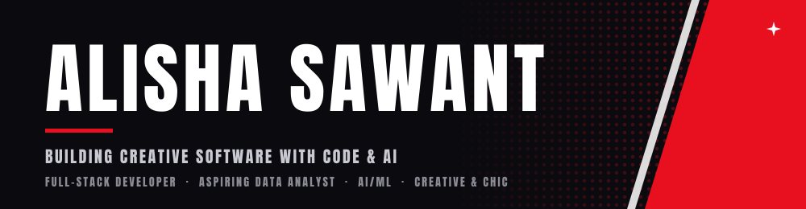

<!--
  Before publishing, search for "TODO":
  1. LinkedIn URL (line ~16)
  2. Creamy Bliss card: replace the repo link (TODO-creamy-bliss-repo) with the real repo name
  Replace repo links with your fork names if they differ from the originals.
  Palette: blue #5A7DE0 · teal #2FA595 · sky #6FA8DC · navy #1F3A5F · bg #F8FCFF
-->

  

 

 

[About](#about-me) · [Projects](#featured-projects) · [Tech Stack](#tech-stack) · [GitHub Stats](#github-activity) · [Contact](#lets-connect)

 

 

## About Me

Final-year Electronics and Computer Science student at Vidyalankar Institute of Technology, Mumbai, with hands-on experience in Python, SQL, data analysis, machine learning, and backend development.

 

## Featured Projects

<table>
<tr>
<td width="50%" valign="top">

### 🛋️ [House Muse](https://github.com/Alisha-0607/House-Muse)
**AI-Based Interior Design and Home Decor System**

An AI system for room analysis and personalized interior design generation, combining YOLOv8, Stable Diffusion XL, and LoRA for image analysis, image-text understanding, and design generation.

`Python` `Django REST` `YOLOv8` `SAM` `BLIP` `SDXL` `LoRA` `PostgreSQL` `OAuth`

</td>
<td width="50%" valign="top">

### 🤟 [IshaaraSpeak](https://github.com/Alisha-0607/ishaara_speak)
**Audio-to-Sign Language System**

A speech-to-text system that generates corresponding 3D sign language output, using CNNs, OpenCV, and MediaPipe for audio and visual processing.

`Python` `JavaScript` `CNN` `OpenCV` `MediaPipe` `3D Animation`

</td>
</tr>
<tr>
<td width="50%" valign="top">

### 🤝 [Corporate Saathi](https://github.com/Alisha-0607/Corporate-Saathi)
**CSR Volunteering Platform**

A Django-based platform for managing CSR activities and user participation, with backend workflows and data management built on SQL.

`Python` `Django` `SQL` `HTML` `CSS` `JavaScript`

</td>
</tr>
<tr>
<td width="50%" valign="top">

### 🍦 [Creamy Bliss](https://github.com/Alisha-0607/TODO-creamy-bliss-repo)
**Ice Cream Parlour E-Commerce Demo**

A full-stack e-commerce demo for an ice cream parlour, with an HTML frontend and a PostgreSQL backend. Inspired by parlour sites like Naturals and Ben & Jerry's.

`HTML` `PostgreSQL`

</tr>
</table>

### 🔗 Also contributed to

- [Net-lab-](https://github.com/Alisha-0607/Net-lab-)
- [india-semiconductor-growth-predictor](https://github.com/Alisha-0607/india-semiconductor-growth-predictor)
- House Muse team repos: [nalawadeakshata29/House-Muse](https://github.com/nalawadeakshata29/House-Muse) · [ArnavGit17/House-Muse](https://github.com/ArnavGit17/House-Muse)

 

## Tech Stack

**Languages**
 

**Backend & Databases**
 

**AI / ML & Data**
 

**Frontend**
 

**Tools & Platforms**
 

 
 

## GitHub Activity

 

  

  

<!--
  Contribution snake: needs .github/workflows/snake.yml to run once.
  It commits snake.svg and snake-dark.svg to an "output" branch.
  This picture tag won't render until that first run finishes.
-->
<picture>
  <source
    media="(prefers-color-scheme: dark)"
    srcset="https://raw.githubusercontent.com/Alisha-0607/Alisha-0607/output/snake-dark.svg" />
  <source
    media="(prefers-color-scheme: light)"
    srcset="https://raw.githubusercontent.com/Alisha-0607/Alisha-0607/output/snake.svg" />
  
</picture>

 
 

## Beyond Code

Away from the keyboard, I'm an **NSS Student Leader** who led a team of 100+ volunteers in planning and running major cultural and community events, and I've won **Gold in Dance and Fashion Show competitions**.

 

## Let's Connect

Whether you're a **recruiter**, a **collaborator** with an idea worth building, or part of a team working on data-driven, AI-powered, or automation-focused solutions, I'd love to hear from you.

  

