<!--
  Before publishing, search for "TODO":
  1. Creamy Bliss repo link (TODO-creamy-bliss-repo)
  Palette: red #E8101F · black #0B0B0F · white #FFFFFF
  Graphics: banner.svg (root) and assets/divider.svg, assets/footer.svg
-->

  

 

  

[About](#about-me) · [Projects](#featured-projects) · [Tech Stack](#tech-stack) · [Activity](#github-activity) · [Contact](#lets-connect)

 

## About Me

<table>
<tr>
<td width="32%" valign="middle">

</td>
<td valign="middle">

Full-stack developer and aspiring data analyst, in the final year of my Electronics and Computer Science degree at Vidyalankar Institute of Technology, Mumbai. I work with Python, SQL, machine learning, and REST APIs, and I love turning raw data into something people can actually understand.

Drawn to telling stories through illustrations and dashboards, I am keen to create projects where data visualisation, analysis, and AI come together to turn numbers into insight, and insight into a compelling story. I'm eager to apply these skills to data-driven, AI-powered, and automation-focused solutions.

</td>
</tr>
</table>

## Featured Projects

<table>
<tr>
<td width="50%" valign="top">

### [House Muse](https://github.com/Alisha-0607/House-Muse)
**AI-Based Interior Design and Home Decor System**

An AI system for room analysis and personalized interior design generation, combining YOLOv8, Stable Diffusion XL, and LoRA for image analysis, image-text understanding, and design generation.

</td>
<td width="50%" valign="top">

### [IshaaraSpeak](https://github.com/Alisha-0607/ishaara_speak)
**Audio-to-Sign Language System**

A speech-to-text system that generates corresponding 3D sign language output, using CNNs, OpenCV, and MediaPipe for audio and visual processing.

</td>
</tr>
<tr>
<td width="50%" valign="top">

### [Corporate Saathi](https://github.com/Alisha-0607/Corporate-Saathi)
**CSR Volunteering Platform**

A Django-based platform for managing CSR activities and user participation, with backend workflows and data management built on SQL.

</td>
<td width="50%" valign="top">

### [Creamy Bliss](https://github.com/Alisha-0607/Creamy-bliss)
**Ice Cream Parlour E-Commerce Demo**

A full-stack e-commerce demo for an ice cream parlour, with an HTML frontend and a PostgreSQL backend. Inspired by parlour sites like Naturals and Ben & Jerry's.

</td>
</tr>
</table>

**Also contributed to**

- [Net-lab-](https://github.com/Alisha-0607/Net-lab-)
- [india-semiconductor-growth-predictor](https://github.com/Alisha-0607/india-semiconductor-growth-predictor)
- House Muse team repos: [nalawadeakshata29/House-Muse](https://github.com/nalawadeakshata29/House-Muse) · [ArnavGit17/House-Muse](https://github.com/ArnavGit17/House-Muse)

## Tech Stack

**Languages**
 

  

**Backend & Databases**
 

  

**AI / ML & Data**
 

  

**Frontend**
 

  

**Tools & Platforms**
 

  

## GitHub Activity

  

  

<!--
  Contribution snake: needs .github/workflows/snake.yml to run once.
  It commits snake.svg and snake-dark.svg to an "output" branch.
  This picture tag won't render until that first run finishes.
-->
<picture>
  <source media="(prefers-color-scheme: dark)" srcset="https://raw.githubusercontent.com/Alisha-0607/Alisha-0607/output/snake-dark.svg" />
  <source media="(prefers-color-scheme: light)" srcset="https://raw.githubusercontent.com/Alisha-0607/Alisha-0607/output/snake.svg" />
  
</picture>

## Beyond Code

<table>
<tr>
<td valign="middle">

Away from the keyboard, I'm an **NSS Student Leader** who led a team of 100+ volunteers in planning and running major cultural and community events, and I've won **Gold in Dance and Fashion Show competitions**.

</td>
<td width="32%" valign="middle">

</td>
</tr>
</table>

## Let's Connect

Whether you're a **recruiter**, a **collaborator** with an idea worth building, or part of a team working on data-driven, AI-powered, or automation-focused solutions, I'd love to hear from you.

 

  

